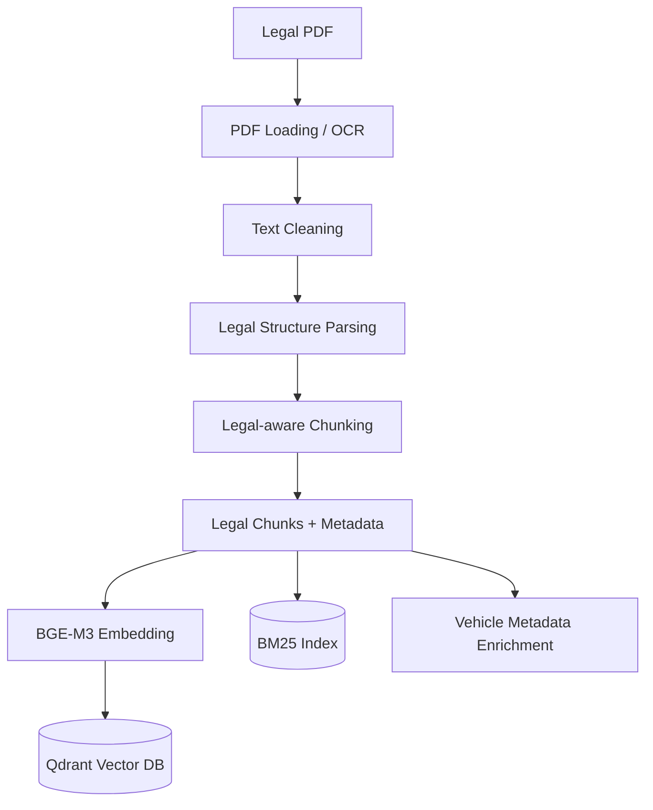
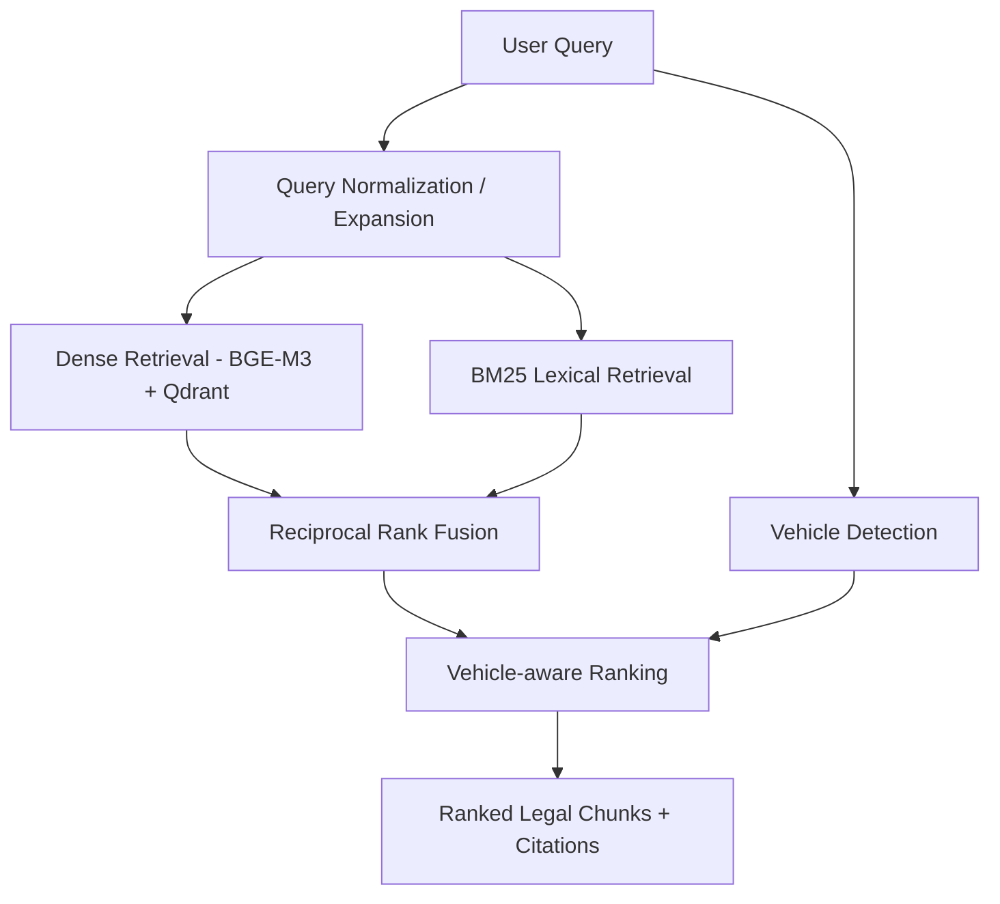
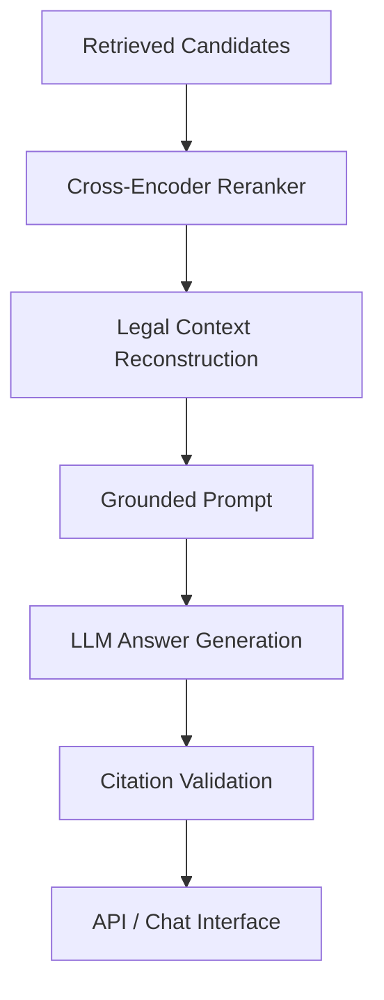

<div align="center">

# 🚦 VietTraffic RAG

### Hệ thống truy xuất và hỏi đáp pháp luật giao thông Việt Nam dựa trên Retrieval-Augmented Generation

**Vietnamese Traffic Law Retrieval & Question Answering System**


**[Tổng quan](#-tổng-quan) · [Kiến trúc](#-kiến-trúc-hệ-thống) · [Cài đặt](#-cài-đặt-và-chạy-thử) · [Kết quả](#-kết-quả-kiểm-thử) · [Roadmap](#-lộ-trình-phát-triển)**

</div>

---

## 📖 Tổng quan

**VietTraffic RAG** là dự án xây dựng hệ thống hỗ trợ tra cứu quy định pháp luật giao thông đường bộ Việt Nam bằng câu hỏi ngôn ngữ tự nhiên. Dự án kết hợp **Dense Retrieval**, **BM25**, **Reciprocal Rank Fusion (RRF)** và **Vehicle-aware Ranking** nhằm truy xuất các điều khoản phù hợp với hành vi và loại phương tiện được đề cập.

Khác với tìm kiếm từ khóa thông thường, VietTraffic RAG hướng tới việc hiểu cách diễn đạt đời thường (ví dụ: *“vượt đèn đỏ”*) và đối chiếu với thuật ngữ trong văn bản pháp luật (ví dụ: *“không chấp hành hiệu lệnh của đèn tín hiệu giao thông”*).

> [!IMPORTANT]
> **Trạng thái dự án:** Pipeline xử lý tài liệu, indexing và các phương pháp retrieval đã được triển khai và kiểm thử trên dữ liệu hiện tại. **Reranking bằng mô hình, tạo câu trả lời bằng LLM, kiểm chứng trích dẫn, API end-to-end và giao diện người dùng chưa được xác nhận hoàn thiện.** Các kết quả dưới đây là kết quả **truy xuất điều khoản**, không phải đánh giá độ chính xác của câu trả lời pháp lý cuối cùng.

### 🎯 Mục tiêu

- Tra cứu quy định giao thông bằng tiếng Việt tự nhiên.
- Truy xuất đúng **văn bản → điều → khoản → điểm**.
- Phân biệt quy định theo **loại phương tiện** và bối cảnh câu hỏi.
- Kết hợp tìm kiếm ngữ nghĩa với tìm kiếm từ khóa.
- Phát triển khả năng trả lời có căn cứ pháp lý và hạn chế hallucination.
- Đo lường chất lượng bằng các chỉ số retrieval và đánh giá end-to-end.

### 💬 Ví dụ câu hỏi

- “Đi xe máy vượt đèn đỏ bị phạt bao nhiêu tiền?”
- “Không đội mũ bảo hiểm bị xử phạt thế nào?”
- “Điều khiển ô tô vượt quá tốc độ bị phạt bao nhiêu?”
- “Người đi bộ không chấp hành đèn tín hiệu giao thông bị xử lý thế nào?”

> **Lưu ý:** Câu hỏi thiếu thông tin như mức vượt tốc độ, vai trò người điều khiển/người ngồi sau hoặc tình tiết vi phạm có thể cần được làm rõ trước khi kết luận mức xử phạt.

---

## 🏗️ Kiến trúc hệ thống

### 1. Indexing pipeline — Đã triển khai



### 2. Retrieval pipeline — Đã triển khai và kiểm thử



### 3. Answer generation pipeline — Định hướng phát triển



**Điểm quan trọng:** Một chunk mô tả *hành vi vi phạm* có thể không chứa *mức phạt* vì mức phạt nằm ở phần mở đầu của khoản. Vì vậy, bước **Legal Context Reconstruction** là hạng mục bắt buộc trước khi hệ thống trả lời số tiền phạt một cách đáng tin cậy.

---

## 🧰 Công nghệ sử dụng

| Nhóm | Công nghệ / phương pháp | Vai trò |
|---|---|---|
| Ngôn ngữ | Python | Xây dựng pipeline và kiểm thử |
| Tài liệu | PDF loading, OCR, text cleaning | Trích xuất văn bản pháp luật |
| Parsing | Legal parser, legal-aware chunker | Bảo toàn cấu trúc điều/khoản/điểm |
| Embedding | `BAAI/bge-m3` | Vector ngữ nghĩa 1.024 chiều |
| Vector database | Qdrant | Lưu trữ và truy vấn embedding |
| Lexical retrieval | `rank-bm25` / BM25 | Tìm kiếm theo từ khóa |
| Hybrid retrieval | Dense + BM25 + RRF | Hợp nhất kết quả từ nhiều nguồn |
| Query processing | Normalization, rule-based expansion | Chuẩn hóa thuật ngữ người dùng |
| Domain ranking | Vehicle detection + metadata boosting | Ưu tiên đúng nhóm phương tiện |
| Container | Docker | Chạy Qdrant cục bộ |
| API / Generation | Các module đã được tạo trong `src/` | Chưa xác nhận tích hợp end-to-end |

---

## 📚 Dữ liệu và chiến lược chunking

### Nguồn dữ liệu đang thử nghiệm

- **Nghị định 168/2024/NĐ-CP**.
- File PDF đã qua OCR: `data/processed/ocr/168-nd-cp.ocr.pdf`.
- Tập dữ liệu đang sử dụng để kiểm thử gồm **55 điều** và **1.036 chunks**.

| Cấp độ chunk | Số lượng |
|---|---:|
| Point-level | 897 |
| Clause-level | 137 |
| Article-level | 2 |
| **Tổng** | **1.036** |

### Legal-aware chunking

Thay vì cắt văn bản theo số ký tự cố định, hệ thống cố gắng bảo toàn cấu trúc pháp lý:

```text
Nghị định 168/2024/NĐ-CP
└── Điều 7
    └── Khoản 7
        └── Điểm c
            └── Không chấp hành hiệu lệnh của đèn tín hiệu giao thông
```

Ví dụ metadata rút gọn:

```json
{
  "chunk_id": "168-2024-ND-CP_dieu-7_khoan-7_diem-c",
  "document_id": "168-2024-ND-CP",
  "article": "7",
  "clause": "7",
  "point": "c",
  "content": "Không chấp hành hiệu lệnh của đèn tín hiệu giao thông;",
  "citation": "Điểm c Khoản 7 Điều 7"
}
```

### Vehicle metadata

Các điều đã được đối chiếu với tiêu đề từ tập dữ liệu hiện tại:

| Điều | Nhóm đối tượng | Nhãn |
|---|---|---|
| 6 | Ô tô và phương tiện tương tự | `car` |
| 7 | Mô tô, xe gắn máy và phương tiện tương tự | `motorcycle` |
| 8 | Xe máy chuyên dùng | `specialized_vehicle` |
| 9 | Xe đạp, xe đạp máy và xe thô sơ | `bicycle` |
| 10 | Người đi bộ | `pedestrian` |

Các chunk chưa đủ cơ sở xác định phương tiện được giữ `vehicle_type = None`; **không** được hiểu mặc định là áp dụng cho mọi phương tiện. Ánh xạ này được giới hạn cho văn bản đang xử lý, không áp dụng máy móc cho nghị định khác.

> [!WARNING]
> Dữ liệu OCR hiện còn lỗi ký tự, dấu tiếng Việt và ký hiệu trang. Nội dung từ OCR **chưa nên được sử dụng như nguồn pháp lý đã xác minh** nếu chưa đối chiếu văn bản chính thức và tình trạng hiệu lực/sửa đổi của quy định.

---

## 📁 Cấu trúc dự án

```text
viettraffic-rag/
├── data/
│   ├── raw/                         # Tài liệu gốc (nếu có)
│   └── processed/
│       ├── ocr/                     # PDF sau OCR
│       └── embeddings/              # Embedding cache + chunk metadata
├── src/
│   ├── api/
│   │   ├── app.py
│   │   └── routes.py
│   ├── ingestion/
│   │   ├── pdf_loader.py
│   │   ├── ocr.py
│   │   └── legal_parser.py
│   ├── preprocessing/
│   │   ├── cleaner.py
│   │   └── vehicle_metadata.py
│   ├── chunking/
│   │   └── legal_chunker.py
│   ├── schemas/
│   │   ├── document.py
│   │   ├── chunk.py
│   │   └── query.py
│   ├── embeddings/
│   │   └── embedder.py
│   ├── vectordb/
│   │   └── qdrant_store.py
│   ├── lexical/
│   │   └── bm25_index.py
│   ├── query/
│   │   ├── normalizer.py
│   │   ├── rewriter.py
│   │   └── vehicle_detector.py
│   ├── retrieval/
│   │   ├── vector_retriever.py
│   │   ├── multi_query_retriever.py
│   │   ├── hybrid_retriever.py
│   │   └── vehicle_aware_retriever.py
│   ├── rerank/
│   │   └── reranker.py
│   ├── generation/
│   │   ├── citation.py
│   │   └── grounded_answer.py
│   ├── prompts/
│   │   └── legal_qa.py
│   ├── llm/
│   │   └── client.py
│   ├── eval/
│   │   └── rag_metrics.py
│   ├── observability/
│   │   └── tracing.py
│   └── pipelines/
│       ├── index_pipeline.py
│       └── query_pipeline.py
└── tests/
    ├── test_multi_query_retrieval.py
    ├── test_hybrid_retrieval.py
    ├── debug_vehicle_metadata.py
    └── test_vehicle_aware_retrieval.py
```

> Cấu trúc phản ánh các module đã được thảo luận trong quá trình phát triển; một số module hiện có thể mới ở mức khung hoặc chưa tích hợp. Tên file test và cache phụ thuộc phiên bản đang làm việc.

---

## 🚀 Cài đặt và chạy thử

### Yêu cầu

- Python 3 và môi trường ảo `venv`.
- Docker Engine đang hoạt động.
- Qdrant chạy tại `http://localhost:6333`.
- Các thư viện Python tương ứng với source code (`sentence-transformers`/embedding dependencies, `qdrant-client`, `rank-bm25`, v.v.).
- Dữ liệu đã được xử lý và collection Qdrant đã được index nếu muốn chạy các bài kiểm thử retrieval bên dưới.

### 1. Clone repository

```bash
git clone <YOUR_REPOSITORY_URL>
cd viettraffic-rag
```

### 2. Tạo môi trường Python

```bash
python3 -m venv .venv
source .venv/bin/activate
python -m pip install --upgrade pip
```

Cài dependency từ file quản lý dependency **nếu repository có cung cấp**:

```bash
# Chạy khi dự án có requirements.txt
pip install -r requirements.txt
```

> Tài liệu hiện có chưa xác nhận nội dung `requirements.txt` hoặc `pyproject.toml`. Hãy bổ sung và khóa phiên bản dependency trước khi phát hành repository.

### 3. Khởi động Qdrant

Nếu chưa có container Qdrant, có thể tạo container cục bộ:

```bash
docker run -d \
  --name viettraffic-qdrant \
  -p 6333:6333 \
  -p 6334:6334 \
  -v "$(pwd)/qdrant_storage:/qdrant/storage" \
  qdrant/qdrant
```

Nếu container đã tồn tại:

```bash
docker start viettraffic-qdrant
```

Kiểm tra dịch vụ:

```bash
curl http://localhost:6333/collections
```

> Tên container ở trên chỉ là **ví dụ cho môi trường mới**. Nếu bạn đã có Qdrant chạy với tên khác, không cần tạo container thứ hai.

### 4. Chuẩn bị dữ liệu

Các bài kiểm thử hiện tại dùng:

```text
data/processed/embeddings/dbc075dd322c83ac.json
```

Và collection:

```text
viettraffic_legal
```

Các file cache hoặc dữ liệu nguồn lớn có thể không được commit lên Git. Nếu thiếu chúng, cần chạy quy trình ingestion/indexing phù hợp với phiên bản repository trước khi kiểm thử. Lệnh CLI indexing thống nhất **chưa được xác nhận** trong tài liệu hiện tại.

### 5. Chạy kiểm thử

Kiểm tra cú pháp:

```bash
python -m py_compile \
  src/retrieval/vehicle_aware_retriever.py \
  tests/test_vehicle_aware_retrieval.py
```

Kiểm tra metadata:

```bash
PYTHONPATH=. python tests/debug_vehicle_metadata.py
```

Kiểm thử Multi-Query Retrieval:

```bash
PYTHONPATH=. python tests/test_multi_query_retrieval.py
```

Kiểm thử Hybrid Retrieval:

```bash
PYTHONPATH=. python tests/test_hybrid_retrieval.py
```

Kiểm thử Vehicle-aware Retrieval:

```bash
PYTHONPATH=. python tests/test_vehicle_aware_retrieval.py
```

**Lưu ý:** Các file trong `tests/` ở giai đoạn này chủ yếu là script kiểm tra thủ công/in kết quả. Chưa nên coi chúng là một bộ test tự động hoàn chỉnh có thể chạy bằng `pytest` nếu chưa chuẩn hóa assertions và fixtures.

---

## 🔎 Các phương pháp retrieval

### Dense Retrieval

Mã hóa câu hỏi bằng **BGE-M3**, sau đó truy vấn vector tương đồng trong Qdrant. Phù hợp khi câu hỏi diễn đạt khác từ ngữ trong văn bản pháp luật.

### Multi-Query Retrieval

Mở rộng câu hỏi theo các cách diễn đạt pháp lý rồi hợp nhất kết quả bằng **RRF**. Ví dụ:

```text
"vượt đèn đỏ"
      ↓
"không chấp hành hiệu lệnh của đèn tín hiệu giao thông"
```

### BM25 Retrieval

Tìm kiếm theo từ khóa để bổ trợ cho semantic search, đặc biệt với thuật ngữ pháp lý cụ thể.

### Hybrid Retrieval

Kết hợp Dense và BM25 bằng Reciprocal Rank Fusion:

\[
\operatorname{RRF}(d) = \sum_{r \in R} \frac{1}{k + \operatorname{rank}_r(d)}
\]

Trong đó `R` là các danh sách kết quả, `k` là hằng số làm mượt thứ hạng (hiện dùng `60` trong quá trình thử nghiệm).

### Vehicle-aware Ranking

Nhận diện phương tiện từ câu hỏi và điều chỉnh điểm kết quả theo metadata đã xác minh:

```text
adjusted_score = rrf_score + vehicle_boost       # Cùng nhóm phương tiện
adjusted_score = rrf_score - mismatch_penalty    # Khác nhóm phương tiện
adjusted_score = rrf_score                       # Chưa xác định / không có nhóm
```

Trong bài kiểm thử gần nhất, hệ số thử nghiệm là `vehicle_boost = 0.005` và `mismatch_penalty = 0.005`. Đây là **heuristic**, chưa được tối ưu trên tập đánh giá có nhãn và không phải xác suất đúng.

---

## 🧪 Kết quả kiểm thử

### Kết quả xác nhận trên môi trường phát triển

| Hạng mục | Kết quả |
|---|---|
| Số điều được xử lý | 55 |
| Số legal chunks | 1.036 |
| BGE-M3 embedding dimension | 1.024 |
| BM25 + Qdrant | Hoạt động trong các script kiểm thử |
| Vehicle metadata | Kiểm thử PASS |
| Vehicle detector | 5 trường hợp thử nghiệm PASS |
| Vehicle-aware retrieval | Chạy thành công |

### Ví dụ 1 — Xe máy vượt đèn đỏ

**Query:** `Đi xe máy vượt đèn đỏ bị phạt bao nhiêu tiền?`

| Phương pháp | Vị trí chunk mục tiêu |
|---|---:|
| Hybrid Retrieval (trước Vehicle-aware) | Rank 2 |
| Vehicle-aware Hybrid Retrieval | **Rank 1** |

**Chunk mục tiêu:**

```text
Điểm c Khoản 7 Điều 7
Không chấp hành hiệu lệnh của đèn tín hiệu giao thông;
```

**Điểm xếp hạng quan sát:** `RRF 0.04542 → Adjusted 0.05042`.

### Ví dụ 2 — Ô tô vượt tốc độ

**Query:** `Điều khiển ô tô vượt quá tốc độ bị phạt bao nhiêu?`

Kết quả đầu tiên trong bài kiểm thử Vehicle-aware:

```text
Điểm a Khoản 6 Điều 6
Điều khiển xe chạy quá tốc độ quy định trên 20 km/h đến 35 km/h;
```

Kết quả **liên quan**, nhưng **không đủ để kết luận mức phạt** vì câu hỏi chưa nêu vượt tốc độ bao nhiêu km/h. Các khung tốc độ khác cũng phải được xét.

### Ví dụ 3 — Không đội mũ bảo hiểm

Hệ thống tìm được các chunk liên quan tới người điều khiển, người được chở và các nhóm phương tiện khác nhau. Cần phân biệt **vai trò người vi phạm** trước khi đưa ra câu trả lời cụ thể.

> [!NOTE]
> Những kết quả trên là **quan sát từ một số câu hỏi kiểm thử**, không phải chỉ số benchmark tổng quát. Hiện **chưa có** kết quả định lượng đáng tin cậy cho `Hit@1`, `Recall@5` hoặc `MRR@10` trên tập câu hỏi được gắn nhãn.

---

## 🗺️ Lộ trình phát triển

### Đã thực hiện

- [x] Thiết kế cấu trúc dự án theo module.
- [x] Đọc PDF, OCR và làm sạch văn bản ở mức cơ bản.
- [x] Phân tích cấu trúc điều/khoản/điểm.
- [x] Legal-aware chunking.
- [x] BGE-M3 embeddings và cache.
- [x] Index và truy vấn Qdrant.
- [x] Dense Retrieval.
- [x] Query normalization và rule-based expansion.
- [x] Multi-Query Retrieval.
- [x] BM25 Retrieval.
- [x] Hybrid Retrieval với RRF.
- [x] Vehicle detection và vehicle metadata enrichment.
- [x] Vehicle-aware Ranking và kiểm thử thủ công.

### Đang phát triển / cần hoàn thiện

- [ ] **Retrieval Evaluation:** Bộ câu hỏi có nhãn, `Hit@1`, `Recall@5`, `MRR@10`.
- [ ] **Cross-Encoder Reranker:** Xếp hạng lại các ứng viên theo mức độ liên quan.
- [ ] **Legal Context Reconstruction:** Ghép hành vi với phần quy định mức tiền phạt và hình thức xử lý.
- [ ] **OCR Quality Assurance:** Đối chiếu văn bản chính thức và sửa lỗi OCR.
- [ ] **Legal Document Versioning:** Theo dõi hiệu lực, sửa đổi, bổ sung và nguồn văn bản.
- [ ] **Grounded Answer Generation:** Tích hợp LLM để trả lời dựa trên bằng chứng.
- [ ] **Citation Validation:** Kiểm tra điều/khoản/điểm được dẫn có tồn tại và hỗ trợ kết luận.
- [ ] **Advanced Query Understanding:** Phương tiện, vai trò, mức vượt tốc độ, tình tiết.
- [ ] **FastAPI Integration:** Hoàn thiện API hỏi đáp và tìm kiếm end-to-end.
- [ ] **Frontend:** Giao diện chat, hiển thị trích dẫn và nguồn.
- [ ] **Automated Tests / CI:** Unit, integration và regression tests.
- [ ] **Observability:** Latency, retrieval diagnostics, tracing và lỗi.
- [ ] **Deployment:** Docker Compose, cấu hình môi trường, triển khai.
- [ ] **Data Expansion:** Bổ sung các văn bản pháp luật liên quan sau khi kiểm chứng nguồn và hiệu lực.

---

## ⚠️ Giới hạn và trách nhiệm sử dụng

- **Không phải tư vấn pháp lý:** Dự án phục vụ nghiên cứu, học tập và phát triển phần mềm; kết quả không thay thế việc tra cứu văn bản pháp luật chính thức hoặc tư vấn chuyên môn.
- **Dữ liệu có thể lỗi thời:** Cần xác minh hiệu lực, văn bản sửa đổi/bổ sung và thời điểm áp dụng trước khi sử dụng thông tin.
- **OCR chưa hoàn hảo:** Một số lỗi nhận dạng có thể ảnh hưởng đến nội dung và mức phạt.
- **Thiếu ngữ cảnh:** Loại phương tiện, người điều khiển/người ngồi sau, mức vượt tốc độ hoặc tình tiết liên quan có thể làm thay đổi quy định áp dụng.
- **Chưa có benchmark diện rộng:** Không suy rộng kết quả từ một số câu hỏi thử nghiệm thành độ chính xác tổng thể.

---

## 🤝 Đóng góp

Đóng góp về dữ liệu, xử lý OCR, đánh giá retrieval, NLP tiếng Việt và kiểm thử đều được hoan nghênh. Khi đề xuất thay đổi liên quan đến pháp luật, vui lòng kèm **nguồn văn bản chính thức, điều khoản liên quan và thông tin hiệu lực** để có thể kiểm chứng.

## 📄 Giấy phép

**Chưa xác định.** Vui lòng bổ sung file `LICENSE` trước khi công bố điều kiện sử dụng hoặc tái phân phối mã nguồn. Quyền sử dụng mã nguồn và quyền sử dụng tài liệu pháp luật/dữ liệu đầu vào cần được xem xét riêng.

---

<div align="center">

**VietTraffic RAG** — Building more reliable Vietnamese legal information retrieval, one citation at a time.

*Active development · Retrieval-first · Evidence-grounded by design*

</div>
